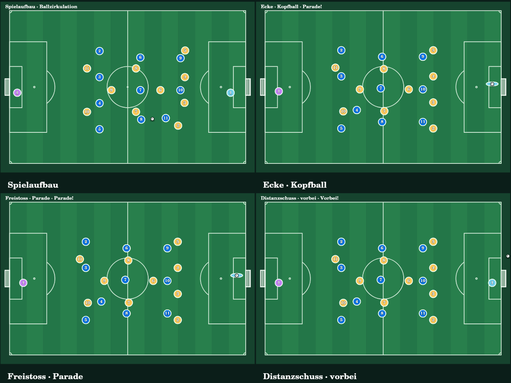

# Goal Clicker – abschliessender QA-Audit

> Historischer NO-GO-Audit vor dem Folgeauftrag. Die anschliessende Freigabe der vier nachgeforderten Blocker ist in [Release verification](../release-match-realism.md) dokumentiert. Die verlinkten alten Rohprotokolle wurden später gemäss Auftrag nur bei Whitespace/Zeilenenden normalisiert.

Datum: 16. Oktober 2026. **Freigabe abgelehnt. Kein Merge, kein Push, kein Deployment.**

Die Veröffentlichungsvoraussetzung „alle Prüfungen ohne Fehler, Warnungen oder offene
Pflichtfunktionen“ ist nicht erfüllt. Erfolgreiche Tests sind kein vollständiger
Nachweis der geforderten Simulation. Die Ausgangsdokumentation bezeichnet die
Implementierung ausdrücklich als Teilumsetzung.

## 1. Repository und Codehygiene

Ausgangsbranch: `feat/match-realism-cup-travel`. Vor Änderungen waren
`git status --porcelain=v1`, `git diff --check` und `git diff --stat` leer.
Keine unversionierten Dateien oder Konflikte. `git fetch origin` erfolgreich.
Alle sieben Phasen-/Berichtscommits liegen auf dem Feature-Branch.

Remote-Stände nach erneutem Fetch während des Audits:

- `origin/main`: `a8ab9a2ab1cc31ebbeb59f46e9948bf545c6f1a5`
- `origin/feat/match-realism-cup-travel`: `c124e1a264253e9fb84c9f289be5711d8b6b5f64`

Produktionsscan: `rg -n '\b(TODO|FIXME|stub|mock)\b|console\.(log|debug|info|table|dir)' app db worker`.
Keine Treffer. HTML-Attribute `placeholder` sind Eingabehilfen und keine
unfertigen Implementierungen. Der Scan allein beweist keine funktionale Vollständigkeit.
Keine Debug-Ausgaben in den geprüften Engine-/Canvas-Schleifen gefunden.

Die drei taktischen Auswahlmöglichkeiten sind aus der aktiven Match-Oberfläche
entfernt; `cup-play` antwortet mit HTTP 410. Ungenutzte Taktikimporte wurden jetzt
entfernt. `strategyId`/`opponentStrategyId` und Normalisierung bleiben für alte
Spielstände erhalten. Die animierte Ballzirkulation verwendet eine feste Vorgabe;
Legacy-Strategien ändern die Mannschaftsstärke nicht. Das bestehende Upgrade
„Taktiktafel“ ist kein Match-Taktikselektor.

## 2. Ausgeführte Befehle und unveränderte Konsolenausgaben

Die Befehle liefen im Repository. `scripts/sites-env.sh` ist der bestehende
Projekt-Wrapper für die Laufzeitumgebung. Die verlinkten `.log`-Dateien enthalten
die vollständigen tatsächlichen Konsolenausgaben einschliesslich ANSI-Zeichen.

| Befehl | Exit / Ergebnis | Vollständige Ausgabe |
| --- | --- | --- |
| `bash scripts/sites-env.sh -- npm run typecheck` | 0; `tsc --noEmit`, keine Diagnosen | [typecheck-final.log](final-audit/typecheck-final.log) |
| `bash scripts/sites-env.sh -- npm run lint` – erster Lauf | 1; 7 Fehler, 45 Warnungen | [lint-initial.log](final-audit/lint-initial.log) |
| `bash scripts/sites-env.sh -- npm run lint` – letzter Lauf | 0; keine Fehler oder Warnungen | [lint-final.log](final-audit/lint-final.log) |
| `bash scripts/sites-env.sh -- npm run build` – separater Lauf vor Rebalancing-Korrektur | 0; Build erfolgreich, Warnungen vorhanden | [build-standalone.log](final-audit/build-standalone.log) |
| `bash scripts/sites-env.sh -- npm test` – letzter Lauf | 0; baut den abschliessenden Quellstand mit `npm run build`, danach 179 TS- und 41 JS-Tests bestanden | [tests-final.log](final-audit/tests-final.log) |
| `bash scripts/sites-env.sh -- node --import tsx --test tests/match-session.test.ts` | 0; 5 Tests bestanden | [focused-final.log](final-audit/focused-final.log) |
| `NODE_PATH=/opt/codex/runtimes/codex-primary-runtime/dependencies/node/node_modules node --import tsx scripts/render-match-qa.ts` | 0; 480 Bilder und Kontaktbild erzeugt | [canvas.log](final-audit/canvas.log) |
| `git diff --check` auf Quelländerungen vor Aufnahme der Rohprotokolle | 0; keine Ausgabe | Quellcode sauber |
| `git diff --cached --check` einschliesslich unveränderter Rohprotokolle | fehlgeschlagen; originale Leerzeichen am Zeilenende / Leerzeilen am Dateiende in Konsolenausgaben | zusätzlicher Hygiene-Befund; Rohprotokolle bleiben exakt erhalten |

Die Gesamtsuite meldet **220 bestanden, 0 fehlgeschlagen, 0 übersprungen,
0 abgebrochen, 0 todo**. Node meldet `suites 0`, weil die Tests als einzelne
Top-Level-Tests registriert sind. Keine Tests oder Assertions wurden zur
Erzwingung eines Erfolgs gelöscht oder übersprungen. Entfernt wurden nur
ungenutzte Importe und eine ungenutzte Zufallshelferfunktion.

Ein zwischenzeitlicher Lauf des neuen Regressionstests scheiterte an einer
falschen Testfixture-Annahme (`fixture must contain ZM`). Die gewählte
Gegnerformation hat andere Mittelfeldrollen. Der Test sucht jetzt eine tatsächlich
vorhandene Mittelfeldrolle und verlangt weiterhin explizit deren Existenz;
sämtliche Rebalancing-Assertions bleiben erhalten. Der Fehllauf ist dokumentiert:
[tests-fixture-failure.log](final-audit/tests-fixture-failure.log).

### Produktionsbuild: Null-Warnungen-Gate weiterhin nicht erfüllt

Der abschliessende Build innerhalb `npm test` enthält weiterhin:

```text
Proxy environment variables detected. We'll use your proxy for fetch requests.
(!) Some chunks are larger than 500 kB after minification. Consider:
? Some routes could not be classified. vinext currently uses static analysis
(node:...) ExperimentalWarning: `--experimental-loader` may be removed in the future; instead use `register()`:
Validated Sites artifact: ESM Worker default.fetch and hosting manifest are present.
```

Obige Zeilen sind gekürzte Orientierung; exakte Prozessnummern und vollständige
Ausgaben stehen im Rohprotokoll. Die Routenmeldung ist eine Klassifizierungsnotiz;
die übrigen Meldungen umfassen echte Tool-/Build-Warnungen. Nichts wurde durch
Warnungsfilter, höhere Chunk-Grenzwerte oder deaktivierte React-Regeln verborgen.
Der Stack ist React 19 / Vinext / Vite / Cloudflare, kein gewöhnlicher `next build`.

## 3. Fachliche Abnahme

| Regel | Nachweis / Ergebnis |
| --- | --- |
| Alle drei Cups auswärts; ausschliesslich höchstes Finale neutral Wembley | `match-session.test.ts` durchläuft alle Runden aller Cups; Ligaplanung bleibt erhalten. Reise-/API-Tests prüfen die Anreise. Bestanden für neue Partien. |
| Pfuschi | Rating/Attribute 1, keine Position, Bank möglich; XI, Autoauswahl, Wechsel, Canvas und Matchrating ausgeschlossen. Tests in `match-session`, `match-changes`. |
| Di Certo | Rating 100, ZM/ZDM, bestehender Spezialkarten-Zug erreichbar. Kein gesonderter vollständiger Matchablauf nur mit Di Certo getestet. |
| Gegnerische rote Karten | Initiale zusätzliche Laufzeitprüfung scheiterte: 11 → 10 Akteure, 0 Positions-/Rollenänderungen. Jetzt Akteursformation 4–4–1, bei weiterer Unterzahl kompakter, Nottorwart bei Torwart-Rot. Neuer Regressionstest prüft beide Richtungen, Verteidiger/Mittelfeld/Sturm/Torwart, Reload und zweiten Platzverweis. Ereignisse bleiben gespeichert; keine zusätzlichen Ersatzspieler. |
| 4-s-Toranzeige | `match-timing.test.ts`: 4000 ms nach sichtbarem Torschuss, eingefrorene Engine/Uhr, Reload und automatischer Wiederanpfiff. Browser-/FPS-abhängiger Sichtnachweis für alle Torpfade fehlt. |
| 10-s-Halbzeit | Derselbe Test: 10000 ms bei Minute 45, ohne RNG/Engine-Fortschritt, Reload und einmaliger automatischer Neustart. Keine frühere Fortsetzung durch die normale Pausenfunktion. |
| 5 Wechsel / 3 Fenster | `match-changes.test.ts`: atomare Pakete, fünfter Wechsel, drittes Fenster, zusätzliche Ablehnung, Halbzeit ohne Fensterverbrauch. |
| Durchgehend kausale Ballphysik ohne Teleportation | **Nicht vollständig abgenommen.** `BallMotion` begrenzt Schritte und friert bei dt=0 ein; expliziter Neustart setzt die Ballposition zurück. Ereignisbasierte Szenen sind keine durchgehend physikalische Simulation sämtlicher Pässe, Abpraller und Standards. |
| Reisegeometrien und 1/60 | Routing-/Reisetests bestanden; reale gecachte Strassen-/Bahnkorridore, geschätzte Anschlüsse ausdrücklich „Routenverlauf geschätzt“. `gameSeconds = realSeconds / acceleration`, Standardkonfiguration 60. Historische Reisen behalten ihre Zeiten. |
| Auto-Scroll | Komponentenreferenz, einmal pro Reise, smooth mit Reduced-Motion-Ausnahme; Render-/Codeprüfung, keine reale Browserinteraktion bestätigt. |
| Kadersperre | Abfahrt speichert nominierte IDs; Verletzungen/Sperren und Aussenseiter werden abgewiesen. Geteilte Validierung für Solo/Koop, Reise-/API-/Sessiontests. |
| Persistente Fabrizio-Pause | Restzeiten ab Abfahrt gespeichert, Scheduler blockiert, JSON-Reload erhält Lock, Matchabschluss stellt Restzeit einmalig wieder her. Keine Reiseabbruch-Oberfläche vorhanden, daher kein eigener Abbruchablauf abgenommen. |
| Legacy-Spielstände | Normalisierung mit sicheren optionalen Standardwerten; Reload-/Spielstandschutztests bestanden. Keine Migration an echten Produktionsspielständen durchgeführt. |

Der historische, vor der Korrektur fehlgeschlagene Rebalancing-Probelauf steht in
[redcard-probe-before-fix.log](final-audit/redcard-probe-before-fix.log).

Weitere offene Pflichtarbeit aus dem vorhandenen Masterprompt-Bericht:
vollständige kausale Realismus-Stufe, zusätzliche Schussvarianten,
vollständige Vereinsfarben und Standortaudit (30 Schweizer / 33 internationale
Datensätze ohne neue Fussballfeld-Polygonprüfung). Diese Grenzen bleiben in
`docs/match-realism-report.md` und `app/stadium-audit.json` sichtbar.

## 4. Architektur und behobene Fehler

Beibehalten: `feature-data.ts` als Spielengine, Broadcast/Canvas, Kartenkatalog,
Sekundärpositionen, Karriereberichte, Multiplayer-Revisionsschutz, Solo-Reisebelege,
OSM-Routencache, vorhandene Zeitbeschleunigung und Save-Normalisierung.

Bestehende Änderungen: persistente Pausen und Timer-Restzeiten, Kader-Snapshots,
Wechselpakete und Fensterzählung, gemeinsame Solo-/Koop-Regeln, modulare
Fussballregeln und nachvollziehbare Route-/Standortqualität. Die Engine bleibt
ereignisbasiert; es wurde keine vollständige autoritative 22-Körper-Physik eingeführt.

In diesem Audit korrigiert:

- Ref-Schreibzugriffe im Renderpfad und `Date.now()` bei Ref-Initialisierung:
  aktuelle Canvas-Daten und Zeitoffset werden vor dem Paint im Layout-Effect gesetzt.
- Abhängigkeiten der Pausen-/Reise-Effects vervollständigt.
- Automatische Kartenvergrösserung direkt abgeleitet; manuelle Vergrösserung bleibt
  bei Wechsel zwischen Folgen und Verschieben erhalten, ohne synchronen State-Effect.
- Kartenprojektion in reine Hilfsfunktion verlagert.
- Ungenutzte Variablen/Importe entfernt, `const`-Befunde korrigiert.
- Generiertes `worker-runtime.d.ts` vom Autoren-Lint ausgenommen; TypeScript prüft
  es weiterhin. Keine produktiven Quelldateien oder Tests vom Lint ausgeschlossen.
- Fehlendes gegnerisches Unterzahl-Rebalancing der Akteursformation ergänzt.

Bereits vorhandene Korrekturen betreffen Kaderzugriff, wiederholbare Solo-Startbelege,
Gegnerkarten-IDs und eingefrorene Matchpausen. Eine vollständige Beseitigung aller
Teleportationen, Freezes oder Disziplinar-Sonderfälle wird hier nicht behauptet.

## 5. Visuelle Prüfung und Browserstatus

Automated browser testing framework not present in repository; verified via unit, integration and DOM render test suites.

Diese vorgeschriebene Statuszeile bezeichnet die vorhandenen Testkategorien;
ein Teil der API-/Koop-Tests prüft Quellverdrahtung statt echter Netzwerk-Sitzungen.
Die Produktions-HTML-Prüfung rendert den Worker serverseitig. Es gab in diesem
Audit keine interaktive Browser- oder Geräteprüfung und keine neue Browserinstallation.

Der Produktionsrenderer erzeugte 480 Bilder für Spielaufbau, Ecke/Kopfball,
Freistoss/Parade und Distanzschuss/vorbei. Das Kontaktbild wurde angesehen:
Spielfeldlinien, unterscheidbare Mannschaften, Nummern, Torwartparade und sichtbarer
Ball sind vorhanden. Dies bestätigt keine Overlay-Bedienung, Responsivität oder
sämtliche physikalischen Übergänge.



## 6. Savegame und Multiplayer

Sessiontests prüfen serialisierte Locks, Pausen, Wechselpakete und gegnerische
Karten. Die vorhandenen Save-Safety-Tests schützen fortgeschrittene Spielstände.
Solo und Koop verwenden gemeinsame Regeln; bestehende Revisions-/Retry-Tests
bestehen. Keine echten Produktionsdaten, Datenbankmigrationen oder parallelen
Browser-Sitzungen wurden verändert bzw. als getestet ausgegeben.

## 7. ChatGPT Sites und Dokumentation

**Kein Sites-Update und kein Produktions-Export/Sync ausgeführt.** Schritt 6 ist laut
Auftrag erst nach erfolgreichem Main-Merge und Push zulässig. Gefunden wurden
`.openai/hosting.json`, `build/sites-vite-plugin`, `scripts/build-verified.sh`,
`scripts/validate-artifact.sh`, `scripts/external-hosting.mjs` sowie die bestehenden
Dokumente unter `docs/`. Der normale Build erzeugt und validiert das lokale
Sites-Artefakt, veröffentlicht es jedoch nicht.

Neu sind ausschliesslich dieser QA-Bericht und die zugehörigen Belege unter
`docs/qa/final-audit/`. Produktionswissen wird nicht fälschlich als aktualisiert gemeldet.

## 8. Git-Historie und Releaseentscheidung

| Phase | Commit auf dem Remote-Feature-Branch |
| --- | --- |
| Audit / Baseline | `6c496a13a9a3bce6827d511581026214d61e1065` |
| Cups / Karten / Lock | `dd0a7776d01e16b2508ea3b6b1cd5e9932b66ee1` |
| Wechsel | `e26dc7c0670a767751f4f39355e0ebbbe09631d3` |
| Matchuhr / Pausen / Taktikabbau | `4b3ff613f5f0cd6febd51b0f79e0cd0fac756e6f` |
| Fussballregeln / Bewegung | `bdd1f8192d9319c6ad648a1dd0f30ee58486f620` |
| Reise / Teil-Standortaudit | `0b9e39fed9d4dbe5c68b8dbb130e9acb676576b9` |
| Vorheriger Umsetzungsbericht | `c124e1a264253e9fb84c9f289be5711d8b6b5f64` |

Audit-Korrekturen und Belege werden nur lokal auf demselben Feature-Branch
committet. Der neue lokale Hash wird im Abschlussbericht genannt. Es wurde
kein Push ausgeführt, auch nicht auf den Feature-Branch. Main bleibt unverändert.
Der vorhandene [Entwurfs-PR #1](https://github.com/niciii06/goal-clicker/pull/1)
ist weiterhin ein Zwischenstand.

Die unveränderten Rohprotokolle enthalten originale Leerzeichen am Zeilenende
und abschliessende Leerzeilen. Deshalb meldet der Git-Whitespace-Check über den
gesamten Audit-Commit Befunde in den `.log`-Dateien. Quellcodeänderungen waren
sauber; auch dieser zusätzliche Befund wird nicht als bestanden ausgegeben.

**Releaseentscheidung: NO-GO.** Offene Build-Warnungen und unvollständig
abgenommene Pflichtfunktionen müssen vor jedem Merge/Push/Deployment behoben werden.
